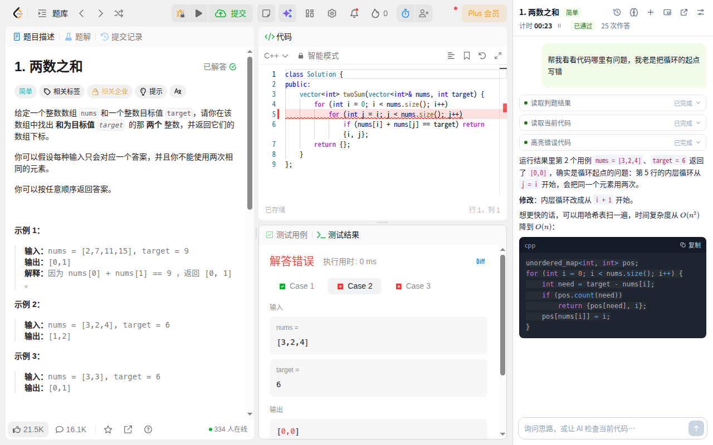
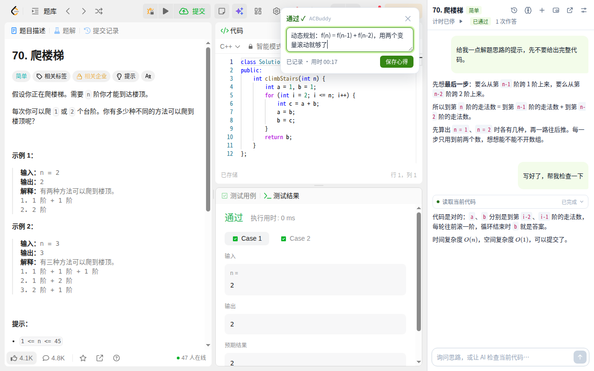
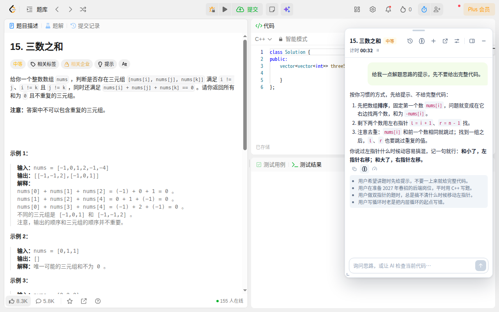
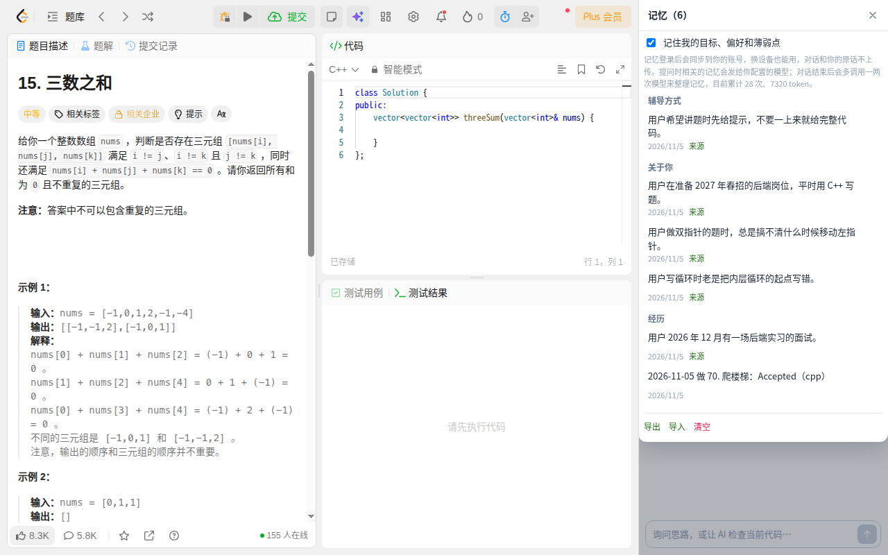
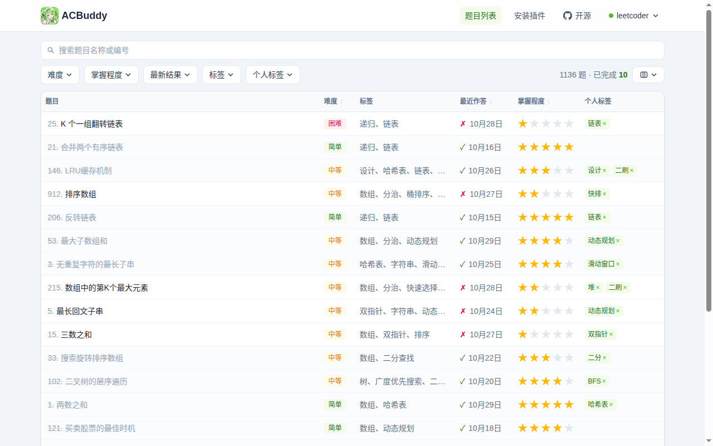

# ACBuddy 🔥

   

开源的刷题助手，帮你准备求职面试里的算法题：浏览器插件在刷题网站上记录作答、辅导解题，网站 [acbuddy.pages.dev](https://acbuddy.pages.dev) 整理面试高频题和你的刷题进度。

- **自动记录**：在力扣国内版、国际版点「提交」后，记下判题结果、用时和语言，再弹出心得卡，随手写下思路
- **AI 辅导**：在力扣、牛客、洛谷、AtCoder 等 6 个刷题网站上读题、看代码，给思路提示或者检查代码，指出出错的行；力扣上运行或提交没通过时，还能看到失败的用例和报错。模型服务和 API Key 用你自己的
- **记忆**：记住你的目标、讲题偏好和常犯的错，以后辅导时用上；可以随时查看、修改、删除，登录后跟随账号同步
- **侧边栏或悬浮窗**：助手放在侧边栏，或者浮在题目页上，可以拖动、调整大小、收起成小圆钮
- **网站**：按难度、标签筛选题目，管理掌握程度、个人标签和笔记，插件记下的作答自动同步过来

<table>
  <tr>
    <td colspan="2" align="center"><br>AI 查错：读取判题结果和当前代码，在编辑器里标出出错的行</td>
  </tr>
  <tr>
    <td width="50%" align="center"><br>提交后记下结果和用时，弹出心得卡</td>
    <td width="50%" align="center"><br>悬浮窗：按记住的偏好先给提示</td>
  </tr>
  <tr>
    <td width="50%" align="center"><br>记忆：随时查看、修改、删除</td>
    <td width="50%" align="center"><br>网站：筛选题目，管理进度</td>
  </tr>
</table>

## 安装浏览器插件

- **Chrome**（116 及以上版本）：从 [Chrome 应用商店](https://chromewebstore.google.com/detail/acbuddy/hkjijhnnjghgndikpiaaeanilgpjfhfk)安装
- **Edge**：从 [Edge 加载项商店](https://microsoftedge.microsoft.com/addons/detail/iaigoapdemeikeigannpdmncejmdkpel)安装
- **无法访问 Chrome 应用商店**：按[安装指南](https://acbuddy.pages.dev/install)从 GitHub Actions 下载安装包，用开发者模式加载

装好后在同一个浏览器登录 ACBuddy，打开力扣题目即可使用。用 AI 助手前，先在它的设置里填 API 地址、API Key 和模型。

## 网站功能

网站是 React + Tailwind 的单页应用，筛选、排序、搜索都在浏览器端完成。

- **题目列表**：显示题号、中文名、难度（简单/中等/困难）、力扣标签，点击标题直达力扣题目页（国内版或国际版，在「显示设置」里切换；剑指 Offer 等国内版独有题始终打开国内版）
- **组合筛选**：难度 × 掌握程度 × 标签 × 最新结果 × 个人标签（后两项需登录），筛选按钮直接显示选中的值
- **搜索**：按题目名称或题号实时过滤
- **排序**：点击表头按难度 / 最近作答 / 掌握程度排序，再点切换升降序，第三次点击恢复默认顺序
- **学习进度**：
  - 「掌握程度」★×5（了解 → 精通），拉满即视为已完成；「紧急程度」!×3
  - 「个人标签」每题最多 10 个（需登录）
  - 「笔记」为每道题记录解题思路，支持简单 Markdown；点击行或标题旁的笔记图标展开笔记与作答记录
  - 「最近作答」（登录后）：最近一次作答的结果与日期
  - 筛选栏显示当前题数与已完成数，悬停可看三档难度的完成数（已完成 = 有 AC 记录 **或** 掌握拉满）
  - 还没设置的星级、紧急标记和标签入口只在悬停或展开该行时出现；只有登录后才有内容的列游客不显示
- **两种使用方式**：不登录时进度存在浏览器 localStorage；登录后存到账号，并与浏览器扩展双向同步。
  首次登录会把本地已记录的进度自动合并上去，不会丢
- **表格自定义**：列可拖拽排序、拖拽调宽、按需隐藏（「紧急」默认隐藏，可在「显示列」里打开），设置持久化
- **分页**：20 / 50 / 100 条每页，带页码省略号

## 快速开始

```bash
npm install
npm run dev       # 本地开发 http://localhost:5173
npm run build     # 类型检查 + 产物构建 → dist/
npm run preview   # 预览构建产物
```

## 部署到 Cloudflare

### 方式一：本机一条命令（需先 `npx wrangler login`）

```bash
npm run deploy    # = npm run build && wrangler pages deploy dist
```

首次部署会自动创建 Pages 项目 `acbuddy`，之后输出访问地址
`https://acbuddy.pages.dev`。

### 方式二：GitHub Actions 自动部署

工作流文件当前是**停用**状态（`.github/workflows/deploy.yml.disabled`），改名去掉
`.disabled` 后缀即可启用，然后：

1. 在仓库 Settings → Secrets 添加：
   - `CLOUDFLARE_API_TOKEN`（权限：Cloudflare Pages: Edit）
   - `CLOUDFLARE_ACCOUNT_ID`
2. push 到 `main` 即自动构建部署

> 注意：工作流只部署前端与 Functions，**不会执行数据库迁移**。schema 有变更时
> 仍需手动跑一次 `npm run db:migrate:remote`。

### 方式三：Cloudflare 控制台 Git 集成

Workers & Pages → 创建 Pages 项目 → 连接 Git 仓库，构建命令 `npm run build`，输出目录 `dist`。

## 后端 API（Chrome 扩展数据通道）

- 技术栈：Cloudflare Pages Functions（`functions/api/[[route]].ts`）+ D1 SQLite（`acbuddy-db`），随 `npm run deploy` 一体部署
- 接口以 `functions/api/[[route]].ts` 为准，文件头写了认证、响应格式和字段语义 —— 记录作答耗时（通过/未通过）、笔记、掌握程度
- 鉴权：会话 Cookie（网页/扩展）或 `Authorization: Bearer <api_key>`；密钥查询 `npm run db:key:remote` / `db:key:local`
- 本地调试：`npm run dev:api` → http://localhost:8788/api/health

### 数据库迁移

迁移由 `scripts/db-migrate.mjs` 执行，`schema_migrations` 表记账，重复执行是空操作：

```bash
npm run db:migrate:local     # 补齐本地所有未执行的迁移（保留数据）
npm run db:migrate:remote    # 同上，作用于线上库
npm run db:migrate:status    # 查看账本
npm run db:reset:local       # 清空重建（本地专用，会删数据）
npm run db:seed:local        # 创建开发账号，随机密码只打印一次
```

新增 schema 变更请**新建编号文件**，不要修改已有的迁移。

### 部署前必读：环境变量

公开部署时在 Cloudflare Pages 的环境变量里配置：

| 变量 | 作用 | 说明 |
| --- | --- | --- |
| `SITE_ORIGIN` | 生产站点 Origin | 默认 `https://acbuddy.pages.dev`，自建部署改成自己的域名 |
| `EXTENSION_IDS` | 扩展 ID 白名单（逗号分隔） | **强烈建议设置**。留空时任何已安装的扩展都能以用户身份调用 API |
| `ALLOW_DEV_ORIGINS` | 放行 `http://localhost:*` 携带凭证 | **生产环境不要设**；本地开发写进 `.dev.vars` |
| `TURNSTILE_SECRET` | Cloudflare Turnstile 密钥（登录、注册的人机验证） | **必须设**，用 `wrangler pages secret put TURNSTILE_SECRET --project-name acbuddy` 存成密钥；没设时注册和登录一律失败 |
| `TURNSTILE_HOSTNAMES` | 允许签发验证令牌的前端域名（逗号分隔） | 默认取 `SITE_ORIGIN` 的域名；本地开发在 `.dev.vars` 里写 `localhost,127.0.0.1`，生产环境不要包含它们 |

登录、注册框的 Turnstile 站点密钥在 `src/lib/turnstile.ts`。自建部署要在 Cloudflare 控制台建自己的小组件，构建时用
`VITE_TURNSTILE_SITE_KEY` 换掉；小组件的域名要包含你的站点，本地调试还要加 `localhost` 和 `127.0.0.1`。

会话 Cookie 是 `SameSite=None`（浏览器扩展需要），所以上面的来源白名单是唯一的
CSRF 防线，放进去的来源等同于能代表用户读写全部数据。安全响应头（CSP、
`frame-ancestors`、nosniff 等）在 `public/_headers` 里，改动前请确认没有削弱它们。

注册和登录都要先通过 Turnstile 人机验证。服务端还内置了注册/登录限流与每用户行数配额，具体数值见 `functions/api/[[route]].ts` 里的 `RATE_LIMITS` 与 `QUOTAS`。

## 题库数据

题库是打包进前端的静态文件 `src/data/problems.json`（格式见 `src/types.ts` 的 `ProblemData`），运行时不发起数据请求。

## 目录结构

```
├── agents.md                   # AI 代理开发约定（开发阶段声明）
├── docs/                       # 记忆系统的设计文档，README 用的截图
├── public/_headers             # Cloudflare Pages 安全响应头（CSP / frame-ancestors / 缓存）
├── functions/api/[[route]].ts  # Pages Functions 后端（/api/*），即接口契约
├── migrations/                 # D1 基础 schema 与保留数据的增量迁移
├── scripts/
│   ├── db-migrate.mjs          # D1 迁移执行器（schema_migrations 账本）
│   └── db-seed.mjs             # 创建开发用户并打印 api_key
├── src/
│   ├── data/problems.json      # 题库数据（打包为独立 chunk，运行时零数据请求）
│   ├── App.tsx                 # 状态中枢：筛选/排序/分页/本地存储
│   ├── components/             # Header / FilterBar / ProblemTable / Pagination / InstallGuide 等
│   ├── lib/filters.ts          # 过滤、排序、分页纯函数
│   ├── lib/markdown.ts         # 极简 Markdown 渲染（先转义再生成标签）
│   ├── lib/storage.ts          # useLocalStorage（写入节流）
│   └── types.ts
├── extension/                  # 浏览器插件（WXT + React，Manifest V3）
├── .dev.vars.example           # 本地开发环境变量模板（复制为 .dev.vars）
├── wrangler.jsonc              # Cloudflare Pages + D1 绑定配置
└── .github/workflows/
    ├── extension-zip.yml       # 插件有改动时构建 ZIP 安装包
    └── deploy.yml.disabled     # GitHub Actions 部署（默认停用）
```

## 许可

代码以 [MIT License](LICENSE) 开源。

题库数据（`src/data/problems.json`）归原站点所有，本仓库仅作学习交流用途，不适用 MIT 许可。如有异议请发邮件到 acbuddy@seek.li，我会立即移除。
